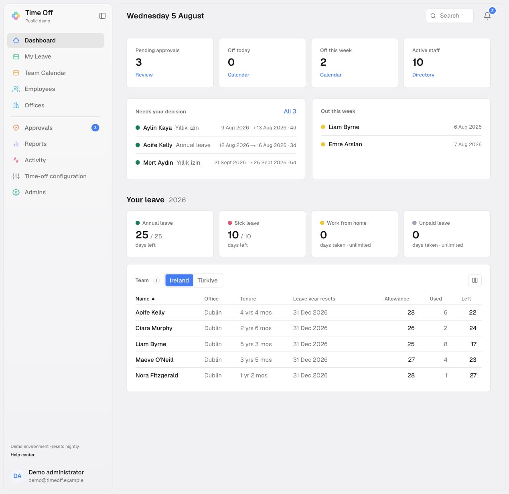
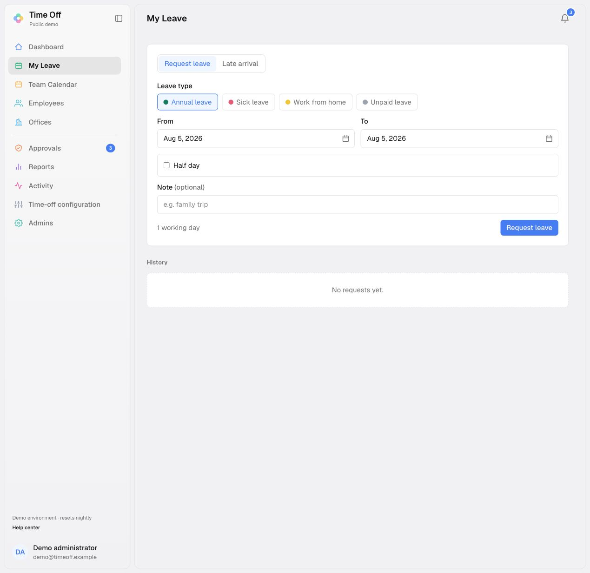
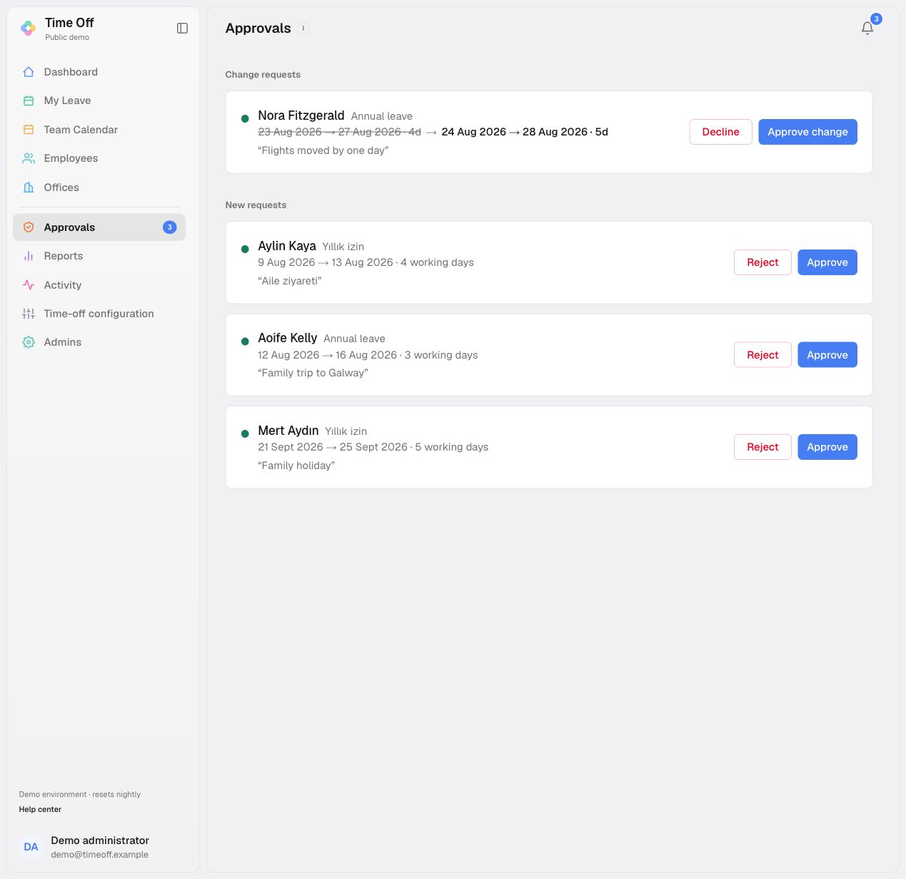
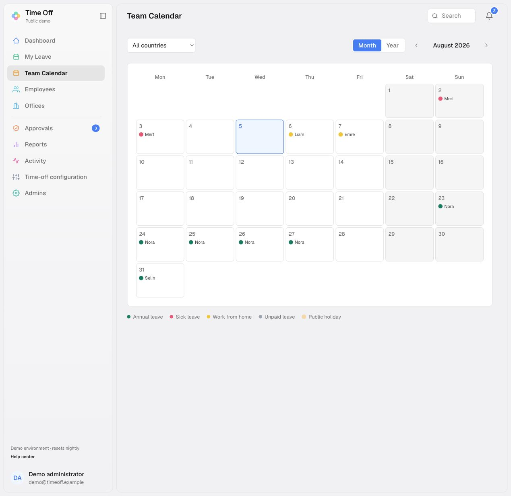
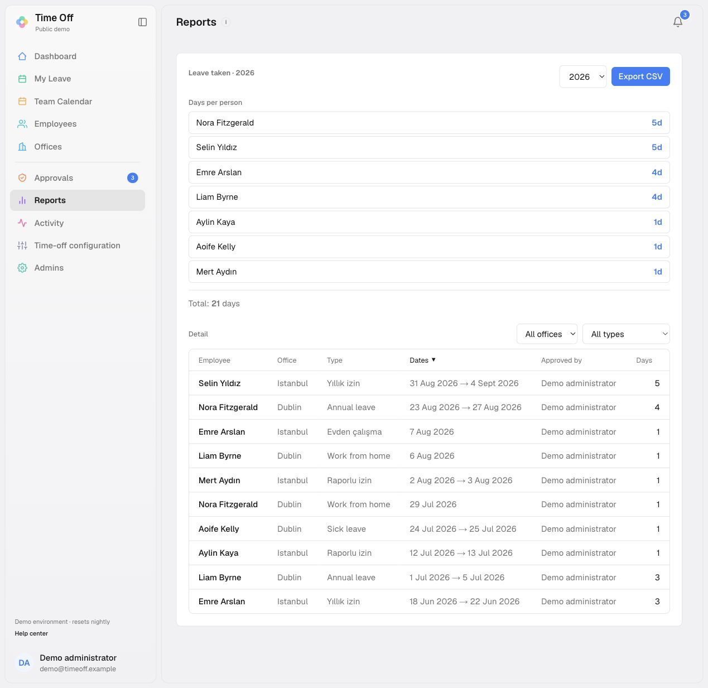
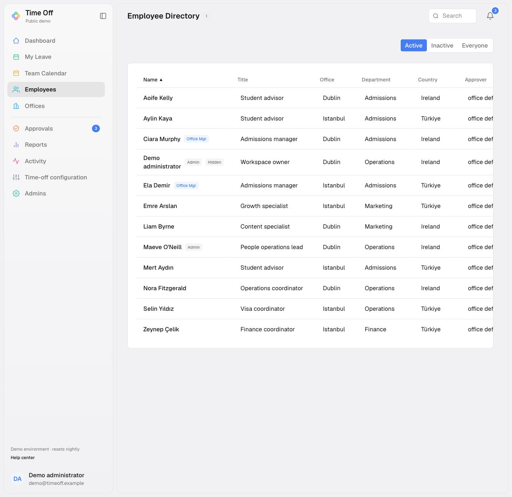
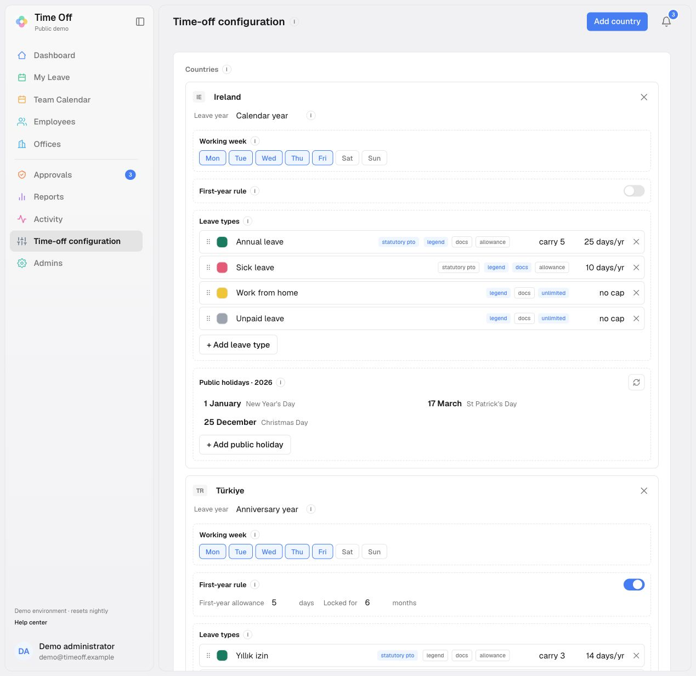

# Time Off

Leave management for small teams, especially teams that span more than one country. Employees request time off and see their balance. Managers approve it. Everyone can check the team calendar. No spreadsheet.

**[Try the live demo →](https://time-off.autotakt.dev)** No signup. You land as an admin of a fictional 12-person team split between Dublin and Istanbul. Break whatever you like, because it resets every night.



## What it does

- **Requests.** Pick a leave type and dates, take half days, add a note or a supporting document. The form shows your balance before and after the request.
- **Approvals.** Each request goes to the right manager, along with its working-day count and balance impact. Managers can approve, decline or propose different dates.
- **Team calendar.** A month view and a full-year view. Colleagues see who is out but not why. Private leave types and notes are visible only to the people who approve that person.
- **Per-country rules.** Each country has its own leave year (calendar or employment anniversary), public holidays, working week, leave types, first-year rule and carryover limit. The demo is set up with Ireland and Türkiye.
- **Balances that keep themselves.** Allowances are pro-rated for joiners, carryover runs at year end and public holidays are imported automatically.
- **Late arrivals, manager notes, reports and a full audit trail.**
- **Email and in-app notifications.** Email goes through Resend and is optional.

| | |
|---|---|
|  |  |
|  |  |
|  |  |

## Stack

Next.js 15, React 19 and Tailwind 4 on the front end. [Convex](https://convex.dev) handles the database, server functions, scheduled jobs and auth (Google sign-in through Convex Auth). Email goes through Resend. Everything is TypeScript, and the free tiers of Convex and Vercel are enough to run it.

## Run it yourself

You need Node 20+ and a free Convex account.

```bash
git clone https://github.com/serdarsalim/Time-Off-Management.git
cd Time-Off-Management
npm install
npx convex dev            # creates your Convex project and writes .env.local
npx @convex-dev/auth      # generates the auth keys on your deployment
```

Then set the backend values. `.env.example` lists all of them.

```bash
npx convex env set SUPERADMIN_EMAILS you@acme.com
npx convex env set SITE_URL http://localhost:3016
npx convex env set AUTH_GOOGLE_ID your-client-id
npx convex env set AUTH_GOOGLE_SECRET your-client-secret
```

Create the Google OAuth client with the redirect URI `https://<your-deployment>.convex.site/api/auth/callback/google`. Add `NEXT_PUBLIC_ORG_NAME=Acme` to `.env.local`, then start everything:

```bash
npm run dev               # http://localhost:3016
```

Sign in with the superadmin email, open **Admins** and click **Add starter leave types & departments**. Then adjust countries, leave types and holidays under **Time-off configuration**.

To deploy, put the Next.js app on Vercel (or any Node host), run `npx convex deploy` for the backend and set the same env vars in production.

### Running a public demo

Set `DEMO_MODE=true` on the Convex deployment and `NEXT_PUBLIC_DEMO_MODE=true` on the frontend. The demo uses anonymous sign-in instead of Google, seeds the fictional team and rebuilds it every night at 01:15 UTC. Don't put real email or OAuth credentials on a demo deployment.

## Help center

The `docs/` folder holds the user guide in Mintlify format. The hosted version is at [time-off-help.autotakt.dev](https://time-off-help.autotakt.dev).

## Credits

Some of the feature set was inspired by [timeoff-management](https://github.com/timeoff-management/timeoff-management-application) (MIT). This is a separate codebase on a different stack.

## License

MIT. See [LICENSE](LICENSE).
